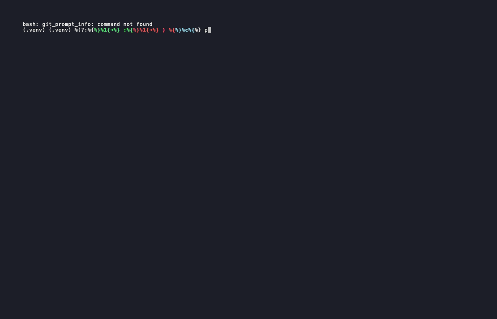

# ⚽ CL Predictor

**A Champions League prediction model in Python, honestly backtested on 189 real matches.**

Predicts every match (1X2, expected goals, most likely scorelines, over/under, both teams to score), simulates the whole season 10,000 times all the way to the 2027 final in Madrid, and measures how good the predictions actually are against real results.



---

## Results

The model was backtested on the full **2025/26 Champions League season (189 matches)**. Every prediction was made using only information available _before_ kickoff.

### Version 1 → Version 2

The first backtest showed that version 1 was **too cautious**: favourites it gave ~65% won 93% of the time. The likely cause was that differences in team strength had too little effect on expected goals.

To fix it without fooling myself, I split the data:

- **Training:** league phase (144 matches): parameters tuned here only
- **Test:** knockout stage (45 matches): never seen during tuning

| Test set (knockout stage, 45 matches) | RPS ↓      | Brier ↓    | Log loss ↓ | Accuracy 1X2 |
| ------------------------------------- | ---------- | ---------- | ---------- | ------------ |
| Version 1                             | 0.2088     | 0.5806     | 0.9757     | 57.8%        |
| **Version 2**                         | **0.1994** | **0.5614** | **0.9514** | **60.0%**    |

**Version 2 has 4.5% lower error (RPS) on matches it never saw during tuning.**

### Full season vs. baselines

| Model (189 matches)             | RPS ↓      | Brier ↓    | Log loss ↓ | Accuracy 1X2 |
| ------------------------------- | ---------- | ---------- | ---------- | ------------ |
| **CL Predictor v2**             | **0.1967** | **0.5385** | **0.9166** | **58.2%**    |
| CL Predictor v1                 | 0.2061     | 0.5620     | 0.9515     | 59.8%        |
| Typical distribution (45/25/30) | 0.2357     | 0.6238     | 1.0351     | 49.7%        |
| Random (33/33/33)               | 0.2478     | 0.6667     | 1.0986     | 49.7%        |

Version 2 beats the typical-distribution baseline by **16.5%** and random guessing by **20.6%** (RPS).

> Note that accuracy went _down_ slightly from v1 to v2 while every probability metric improved. Counting "correct picks" is a poor way to judge a probabilistic forecast; what matters is whether the probabilities are right.

### Calibration: can the percentages be trusted?

| Model said | Matches | Avg. predicted | Actually happened |
| ---------- | ------- | -------------- | ----------------- |
| 0–20%      | 139     | 14%            | 15% ✓             |
| 20–40%     | 255     | 27%            | 25% ✓             |
| 40–60%     | 102     | 50%            | 54% ✓             |
| 60–80%     | 61      | 70%            | 66% ✓             |
| 80–100%    | 10      | 86%            | 100%              |

When version 2 says 70%, it happens about 70% of the time.

### Parameter changes

| Parameter      | Meaning                                       | v1     | v2        |
| -------------- | --------------------------------------------- | ------ | --------- |
| `ELO_TO_GOALS` | how much team strength affects expected goals | 0.0024 | **0.004** |
| `HOME_ADV_ELO` | home advantage in Elo points                  | 55     | **75**    |
| `BASE_GOALS`   | average goals per team                        | 1.4    | **1.6**   |
| `K_FACTOR`     | how fast ratings react to results             | 20     | **10**    |

---

## How the model works

```
Team strength (Elo)  →  Expected goals (xG)  →  Poisson score matrix  →  Probabilities
                                                                       →  Monte Carlo season simulation
```

1. **Elo ratings:** each club's strength, from [clubelo.com](http://clubelo.com). When the API is down, a rolling Elo is used, updated after every match.
2. **Expected goals:** the Elo difference (plus home advantage) is converted into expected goals for each team.
3. **Poisson:** goals are modelled as Poisson-distributed, giving the probability of every scoreline from 0–0 to 10–10, and from that 1X2, over/under, BTTS and clean sheets.
4. **Monte Carlo:** the rest of the season is simulated 10,000 times in the new 36-team league format, through the play-offs and knockout rounds to the final, giving each club's probability of reaching every stage.

### Metrics

- **RPS (Ranked Probability Score):** the standard metric for football forecasts; respects that a draw is "between" a home and away win. Lower is better.
- **Brier score:** squared error of the probabilities. Lower is better.
- **Log loss:** heavily punishes confident mistakes. Lower is better.

---

## Getting started

```bash
git clone https://github.com/Mohamadaloreibi/cl-predictor.git
cd cl-predictor
python -m venv .venv
source .venv/bin/activate          # Windows: .venv\Scripts\activate
pip install -r requirements.txt
```

Try it immediately, no API key needed:

```bash
python cl_predict.py --demo
```

For real data, get a free key from [football-data.org](https://www.football-data.org/client/register), then:

```bash
cp .env.example .env               # and paste your key into .env
```

### Scripts

| Command                | What it does                                                                                  |
| ---------------------- | --------------------------------------------------------------------------------------------- |
| `python cl_predict.py` | Today's matches: predictions, match cards and a live round simulation with goalscorers        |
| `python cl_season.py`  | Simulates the rest of the season 10,000× and plays out one possible road to Madrid            |
| `python backtest.py`   | Tests the model against a finished season and reports metrics, calibration and biggest upsets |
| `python tune.py`       | Tunes parameters on the league phase and evaluates on the knockout stage                      |

Add `--demo` to any script to run it on synthetic data.

---

## Limitations (being honest)

- **Small test set.** 45 knockout matches is enough to show a direction, not to prove a precise number.
- **Possible data leakage.** clubelo.com was unavailable during testing, so the rolling Elo started from present-day ratings, which partly "know" how last season went. True out-of-sample performance is probably slightly worse.
- **Strength only.** The model knows nothing about injuries, suspensions, rotation or tactics.
- **Simplified knockout draw.** Seeding follows UEFA's structure, but exact bracket positions are randomised.
- **`BASE_GOALS` ended at the edge of the search grid**, so the optimum may lie slightly higher.

## Roadmap

- [ ] Shot-based xG from event data (e.g. StatsBomb Open Data) instead of Elo only
- [ ] Re-run the backtest with true historical Elo (no leakage)
- [ ] Weekly public predictions with an open track record
- [ ] Extend to Allsvenskan

---

## About

Built by **Mohamad Al-Oreibi**, a software developer and UEFA C-licensed football coach in Gothenburg, working towards data and AI engineering in football.

_For analysis and learning, not betting advice._
